# Fractal Flight

An animated desktop wallpaper: an endless tour of fractal worlds. Fall from space onto
Mandelbrot planets and dive billions of times deeper, then drift past Mandelbulbs,
Mandelboxes, Menger sponges, Julia sets and kaleidoscopic crystals, under a sky of
galaxies, nebulae and ringed gas giants. Every flight is different and the tour never repeats exactly.

Free and open source (MIT). One HTML file plus WebGL 2, no build step, no dependencies.

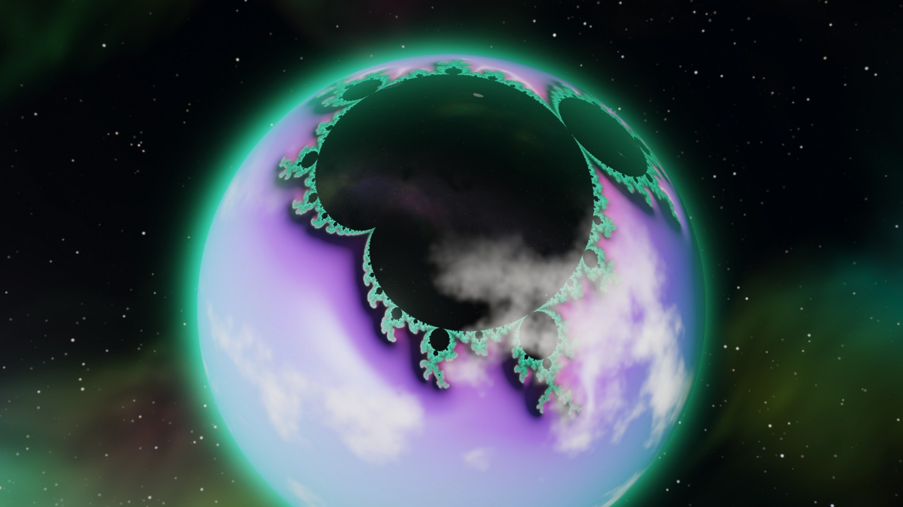

**[Try it in your browser](https://ryan-rc.github.io/fractal-flight/)** (a recent desktop
browser with WebGL 2; it is GPU-heavy).

> **Photosensitivity note.** This is constantly moving imagery with fine detail. It has
> been tuned to avoid flashing and strobing (no sub-pixel jitter, 60 fps, gradual
> resolution changes, slow camera), but if moving patterns bother you, try it in a
> window first, lower the flight speed, or use the planets-only setting.

## Screenshots

| | |
|---|---|
| 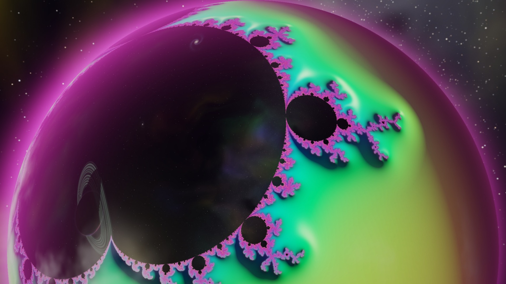 | 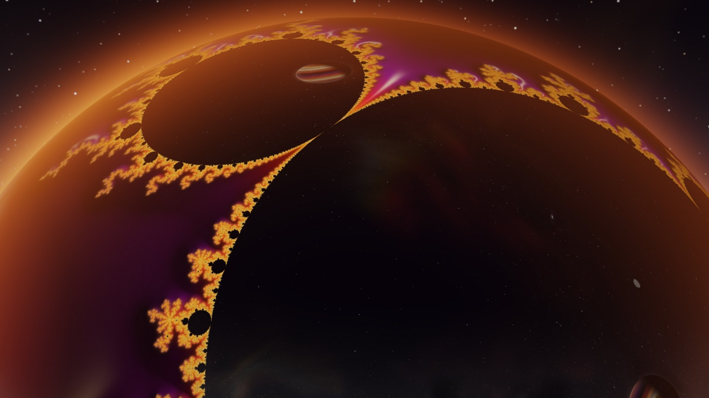 |
| Arriving at a planet: the Mandelbrot set is the continent | Coming down, the horizon still curved |
| 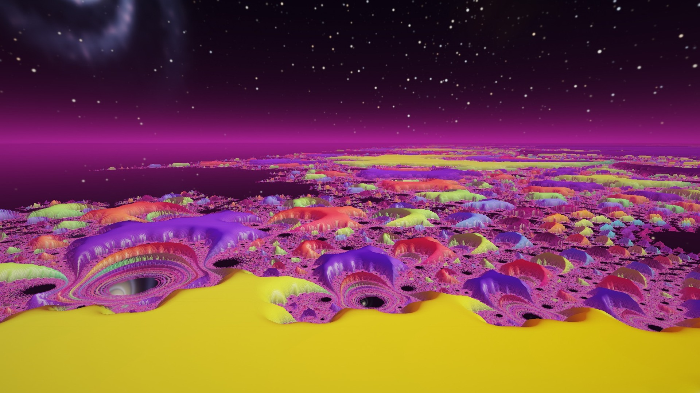 | 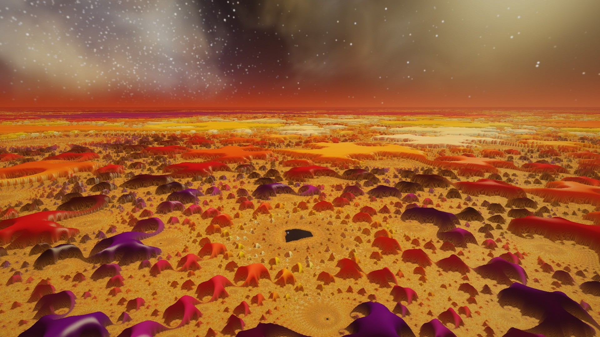 |
| The landscape: plateaus, glowing canyons, mirror lakes | Deep in a dive, hundreds of millions of times closer |
| 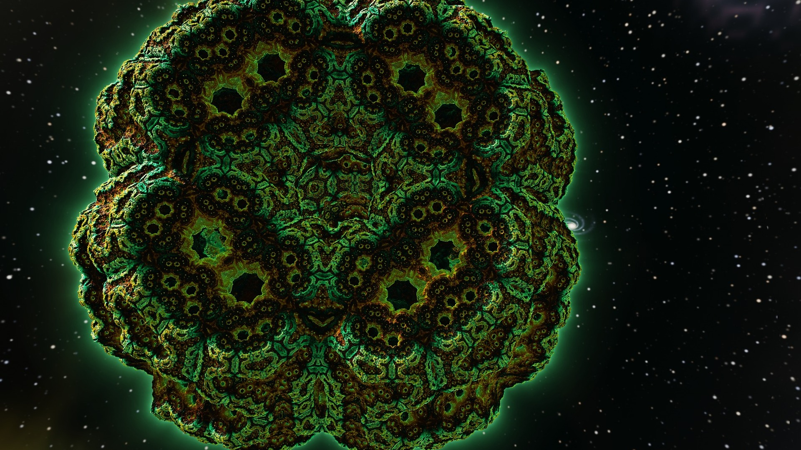 | 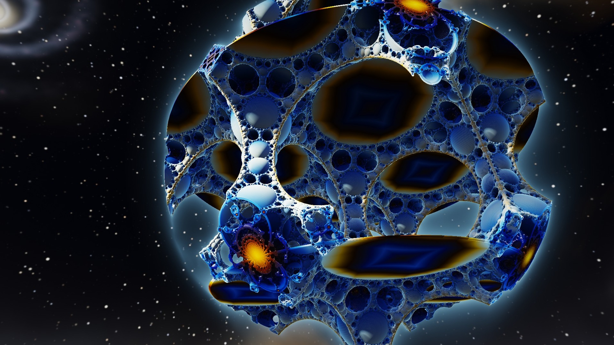 |
| Golden Reliquary (kaleidoscopic IFS) | Frost Foam (Apollonian foam) |
| 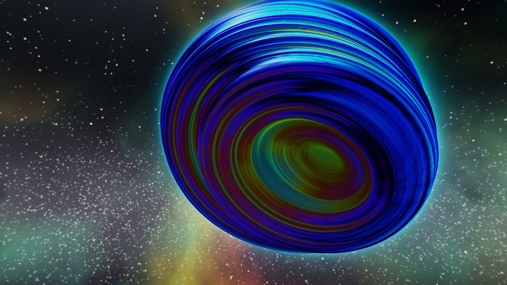 | 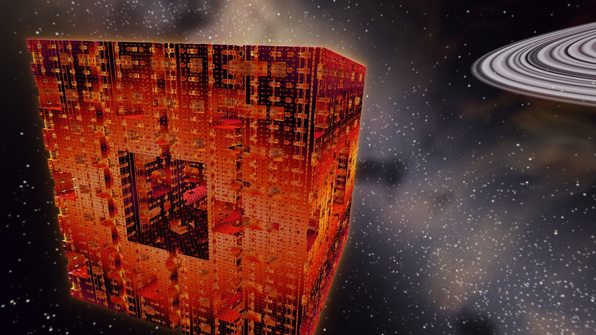 |
| Violet Shell (quaternion Julia set) | Fire Sponge (Menger sponge) |
| 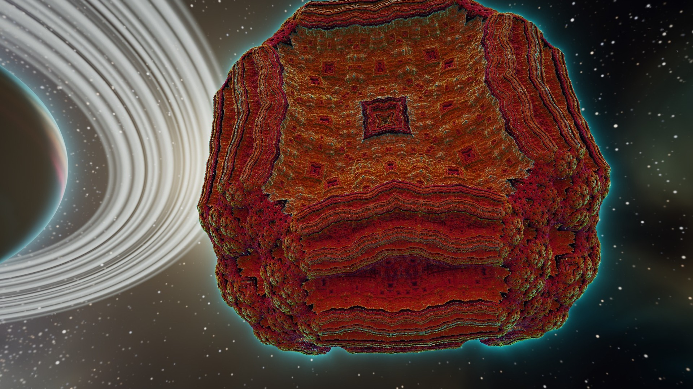 | 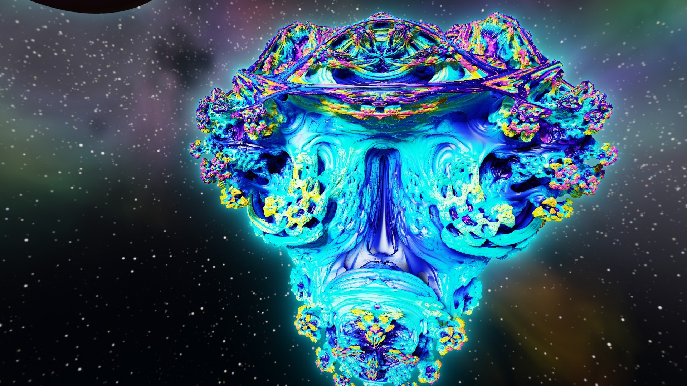 |
| Temple (kaleidoscopic IFS) | Prism Bulb (Mandelbulb) |

All 46 discovered favourites, 10 planets and 36 objects:

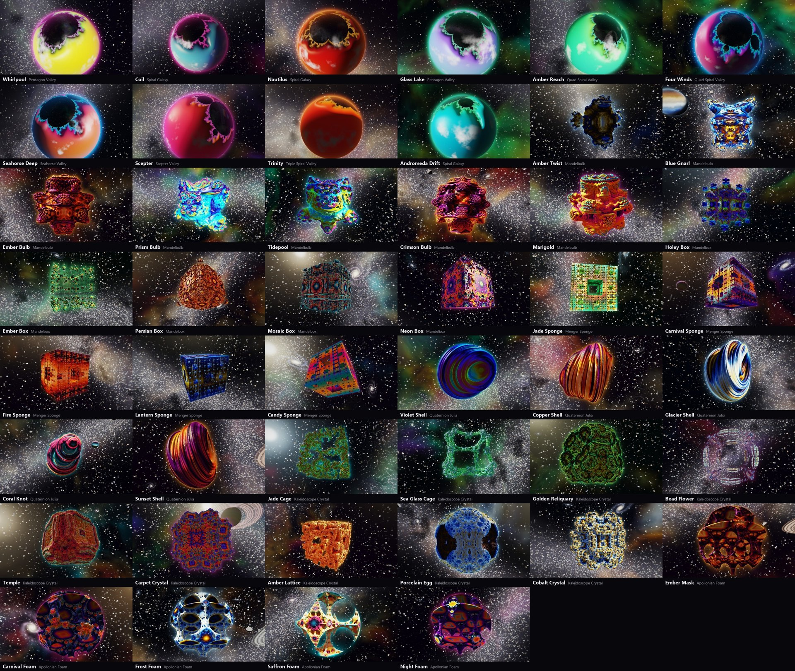

## Use it as your wallpaper (Windows)

1. Install [Lively Wallpaper](https://www.rocksdanister.com/lively/) (free, open source),
   for example `winget install rocksdanister.LivelyWallpaper`.
2. Download this repository (Code > Download ZIP) and unzip it.
3. Drag the folder (or the zip) into Lively and set it on each screen.

Lively's customise panel has flight speed, quality, frame rate (30 or 60 fps), whether
to visit 3D objects between planets, and whether to show each place's name. Each screen
runs its own flight.

It also runs as a plain web page: open `index.html` in a browser. Other wallpaper
engines that show web pages should work too.

## What you'll see

- **Mandelbrot planets.** Each flight starts in space: a globe with the Mandelbrot set
  wrapped on as a continent, the inside of the set as dark oceans, clouds over the open
  sea, an atmosphere glowing at the limb. The camera falls in, the curved horizon
  flattens into a 3D landscape, and the dive carries on to a deep minibrot, millions to
  hundreds of billions of times closer, before fading to the next world.
- **The landscape.** Open areas of the set are raised plateaus, the filaments are glowing
  canyons, and the set itself is a lake that mirrors the sky.
- **3D fractal objects** floating in space: Mandelbulb, Mandelbox, Menger sponge,
  quaternion Julia set, kaleidoscopic IFS crystals and Apollonian foam. The camera comes
  in, skims the surface (slowing right down close up) and pulls away.
- **The sky** is generated for every flight: stars, a Milky Way band with dust lanes,
  nebulae in the scene's colours, spiral galaxies, one or two gas giants with storms
  and rings, and moons.
- **Destinations** come from famous regions of the Mandelbrot set (Seahorse Valley,
  Elephant Valley, the spiral valleys, the Feigenbaum point and more). About two thirds
  of the time the tour visits a discovered favourite, otherwise something new.

## How it works

Everything is in [`index.html`](index.html) (renderer, camera, director) and
[`finder.js`](finder.js) (destinations, run in a Web Worker).

- **Deep zoom** uses perturbation theory: `finder.js` finds a minibrot nucleus with
  Newton's method (periods from the seed point's atom domains, size from the
  minibrot-size estimate) and computes its orbit in double precision; the GPU iterates
  each pixel's float offset from that orbit, rebasing to avoid glitches.
- **Planets**: the complex plane is wrapped onto a sphere with an azimuthal-equidistant
  map centred on the destination, so arc length from the target equals distance in the
  plane and the dive needs no change. The ray-sphere test runs in units of the camera's
  altitude with the constant term computed on the CPU, which keeps it exact from orbit
  down to 10^-12.
- **Terrain** height comes from the distance estimate (log of distance relative to
  altitude); a second pass raises screen columns voxel-space style.
- **3D objects** are ray marched with distance estimates (Mandelbulb, Rrrola's Mandelbox,
  Menger sponge, quaternion Julia, Knighty-style kaleidoscopic IFS, Apollonian
  inversion), with soft shadows, ambient occlusion and orbit-trap colouring.
- **Calm motion**: temporal anti-aliasing reprojects each pixel's surface point into the
  last frame and clamps the history to its neighbourhood, deliberately without sub-pixel
  jitter (jitter made fine detail shimmer at wallpaper frame rates). Render resolution
  drifts a few percent per second to stay inside a GPU budget instead of stepping.
- **Performance**: GPU time is measured with timer queries. On Medium, two screens
  (1440p and 4K) at 60 fps use roughly 35 to 45% of an RTX 4060 Ti.

## Discovering new favourites

The favourites in [`discovered.js`](discovered.js) came from discovery sweeps: hundreds
of random genomes rendered, scored for detail, then picked by eye. The tools are in
[`tools/`](tools) and drive the page in headless Chrome
(`pip install websocket-client numpy pillow`; set `CHROME` if Chrome is somewhere
unusual):

| Script | What it does |
|---|---|
| `tools/discover.py OUT N [kinds]` | N random objects per kind, scored, with contact sheets |
| `tools/planet_discover.py OUT N` | N Mandelbrot destinations per region (needs Node.js), scored |
| `tools/gallery.py OUT.jpg` | Every favourite in `discovered.js` as one named gallery |
| `tools/render.py OUT "name\|query" ...` | Still frames at 1920x1080 |
| `tools/flicker.py OUT "name\|query" ...` | Blinking, flicker and per-frame motion, with heatmaps |

Add a pick to `discovered.js` with a `"name"` and the tour will visit it.

### URL switches

`?still=1&u=0.5` renders one frame halfway through a flight. `&scene=obj` or
`&scene=mandel` forces one kind, `&kind=0..5` a kind of object, `&region=0..10` a region,
`&pal=0..7` a palette, `&seed=N` the random seed, `&dest=<json>` or `&genome=<json>` one
specific planet or object. Live: `&speed=2`, `&quality=0..2`, `&fps=30`, `&labels=0`,
`&taa=0`. In the console, `fractalFlight.stats` shows fps, GPU time and render scale and
`fractalFlight.skip()` jumps to the next flight.

## Credits

Techniques this builds on: perturbation with rebasing (Zhuoran), atom domains and
minibrot size estimates (Claude Heiland-Allen), the Mandelbulb (Daniel White and Paul
Nylander), the Mandelbox (Tom Lowe) and Rrrola's distance estimate for it,
kaleidoscopic IFS (Knighty), and the distance-estimated Julia, Menger and Apollonian
fractals popularised by Inigo Quilez. Palettes blend in Oklab (Björn Ottosson).

## License

[MIT](LICENSE). Use it, change it, share it.
